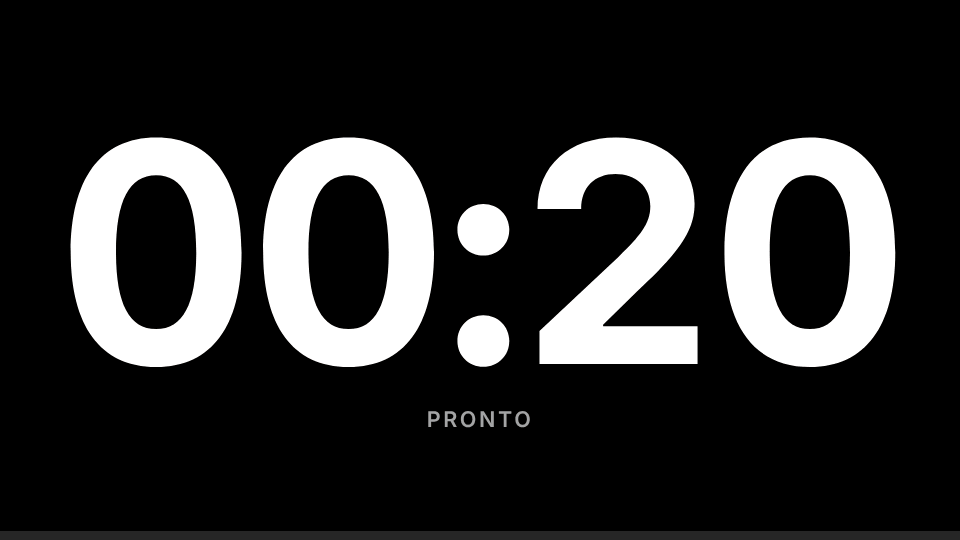
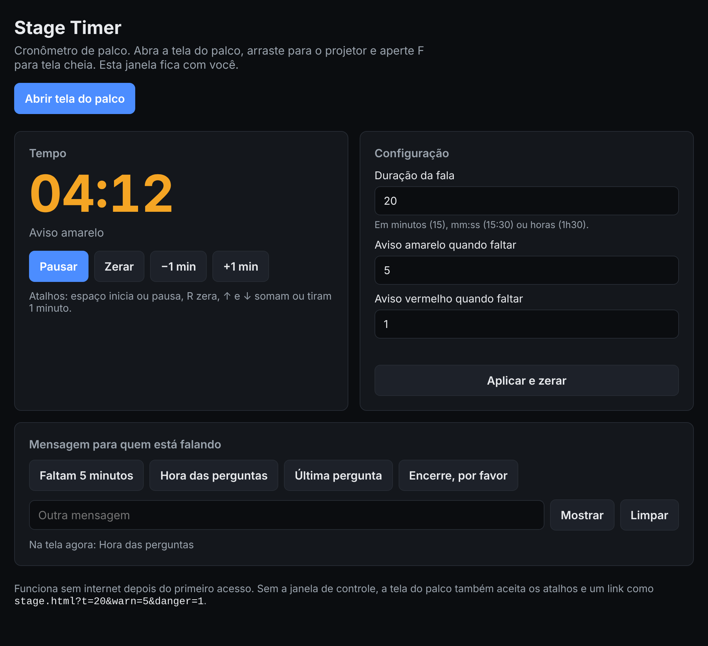

# Stage Timer

[](https://github.com/lisboacesar/stage-timer/actions/workflows/ci.yml)

Cronômetro de palco para palestras e eventos. Quem fala vê o tempo restante em números grandes, e quem organiza controla tudo de outra janela: inicia, pausa, dá mais tempo e manda recados como "Hora das perguntas" sem interromper a fala.

Roda no navegador, sem instalar nada e sem conta. Depois do primeiro acesso, abre até sem internet.

**Abrir:** https://lisboacesar.github.io/stage-timer/

<p align="center">
  
</p>

## Como usar

1. Defina a duração da fala e os dois avisos no painel.
2. Clique em **Abrir tela do palco**, arraste a janela para o projetor ou para o monitor de retorno e aperte **F** para tela cheia.
3. Controle pelo painel. A tela do palco acompanha na hora.

<p align="center">
  
</p>

| Fase | Quando | Tela |
| --- | --- | --- |
| Normal | antes do primeiro aviso | preta |
| Aviso amarelo | faltando o tempo do primeiro aviso (padrão: 5 min) | amarela |
| Aviso vermelho | faltando o tempo do segundo aviso (padrão: 1 min) | vermelha |
| Tempo esgotado | depois do zero | vinho, contando o excedente com `+` |

Os campos de tempo aceitam `15`, `15:30`, `1:15:00`, `1h30`, `90s` e `2,5`. O **+1 min** vale só para a fala atual: **Zerar** volta para a duração configurada, pronto para a próxima pessoa.

### Atalhos

Funcionam no painel e na tela do palco.

| Tecla | Ação |
| --- | --- |
| Espaço | iniciar, pausar ou continuar |
| R | zerar |
| ↑ / ↓ | mais ou menos 1 minuto na fala atual |
| F | tela cheia (só na tela do palco) |

### Só a tela do palco

Sem o painel, a tela do palco funciona sozinha pelos atalhos. Um link já configurado deixa tudo pronto antes do evento:

```
https://lisboacesar.github.io/stage-timer/stage.html?t=20&warn=5&danger=1
```

`t` é a duração, `warn` e `danger` são os avisos, nos mesmos formatos dos campos.

## Como funciona

As janelas ficam no mesmo navegador e no mesmo computador e conversam por [`BroadcastChannel`](https://developer.mozilla.org/docs/Web/API/BroadcastChannel), sem servidor.

- **`src/timer.js`** guarda toda a regra do cronômetro em funções puras, que recebem o estado e devolvem um novo. O tempo decorrido vem do relógio (`Date.now() - startedAt`, mais o que passou antes das pausas), então a contagem continua certa quando o navegador desacelera os timers de uma janela em segundo plano.
- **`src/sync.js`** marca cada mudança com `updatedAt`, e o estado mais novo vence. Uma janela recém-aberta pede o estado atual e adota o das janelas que já estavam abertas, então recarregar o painel no meio de uma fala não perde nada.
- **`src/stage.js`** e **`src/control.js`** só desenham o estado e publicam as ações.
- **`sw.js`** busca primeiro na rede e usa o cache quando a rede falha ou passa de 3 segundos, pensando em auditório com Wi-Fi ruim.
- A tela do palco usa a [Screen Wake Lock API](https://developer.mozilla.org/docs/Web/API/Screen_Wake_Lock_API) para o computador não apagar a tela durante a fala.

Como não há servidor, painel e palco precisam estar no mesmo computador. Controlar pelo celular exigiria um backend com WebSocket, por exemplo.

## Rodar localmente

```sh
python3 -m http.server 8000
```

Depois abra http://localhost:8000. Precisa de um servidor porque módulos ES e service worker não carregam com o arquivo aberto direto do disco.

## Testes

```sh
npm test
```

Usa o test runner do Node (22 ou mais novo), sem dependências. Os testes cobrem a lógica do cronômetro (pausas, fases, ajustes de tempo e formatos de duração) e as regras de sincronização, com janelas simuladas sobre o `BroadcastChannel` do próprio Node. O [CI](.github/workflows/ci.yml) roda tudo a cada push.

## Licença

[MIT](LICENSE)
