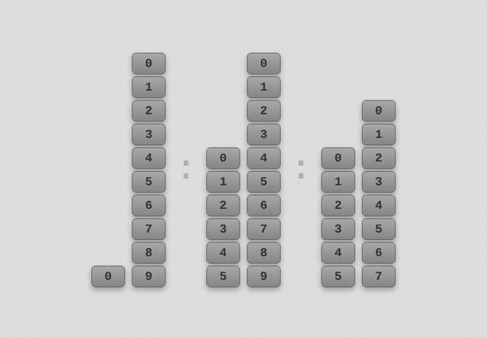

# Falling Bar Clock



Relógio digital em que cada dígito é uma pilha de blocos numerados, do valor atual até 0. Quando um dígito diminui, como o 9 que vira 0, a pilha tomba com uma animação e é montada de novo com o valor novo.

**[Ver demo](https://lisboacesar.github.io/falling-bar-clock/)**

## Como funciona

- A cada segundo, `updateClock()` lê a hora e separa os seis dígitos de `HH:MM:SS`.
- `buildBar()` transforma cada dígito numa coluna com `valor + 1` blocos, do valor atual até 0.
- Quando o valor novo é menor que o anterior, a coluna recebe a classe `falling`. A animação CSS `fall` gira a coluna 90° em 1,2 s e, depois disso, a coluna é reconstruída com o valor novo.
- Os dois-pontos piscam com uma segunda animação CSS, `blink`.
- O layout se ajusta em telas menores que 768px e, abaixo de 480px, empilha os dígitos na vertical.

## Rodar localmente

Não tem build nem dependências. Abra o `index.html` no navegador ou sirva a pasta:

```bash
python3 -m http.server 8000
```

## Estrutura

| Arquivo | Conteúdo |
| --- | --- |
| `index.html` | os seis dígitos e os dois-pontos |
| `style.css` | blocos, animações `fall` e `blink` e regras para telas pequenas |
| `script.js` | leitura da hora, montagem das colunas e disparo da queda |
